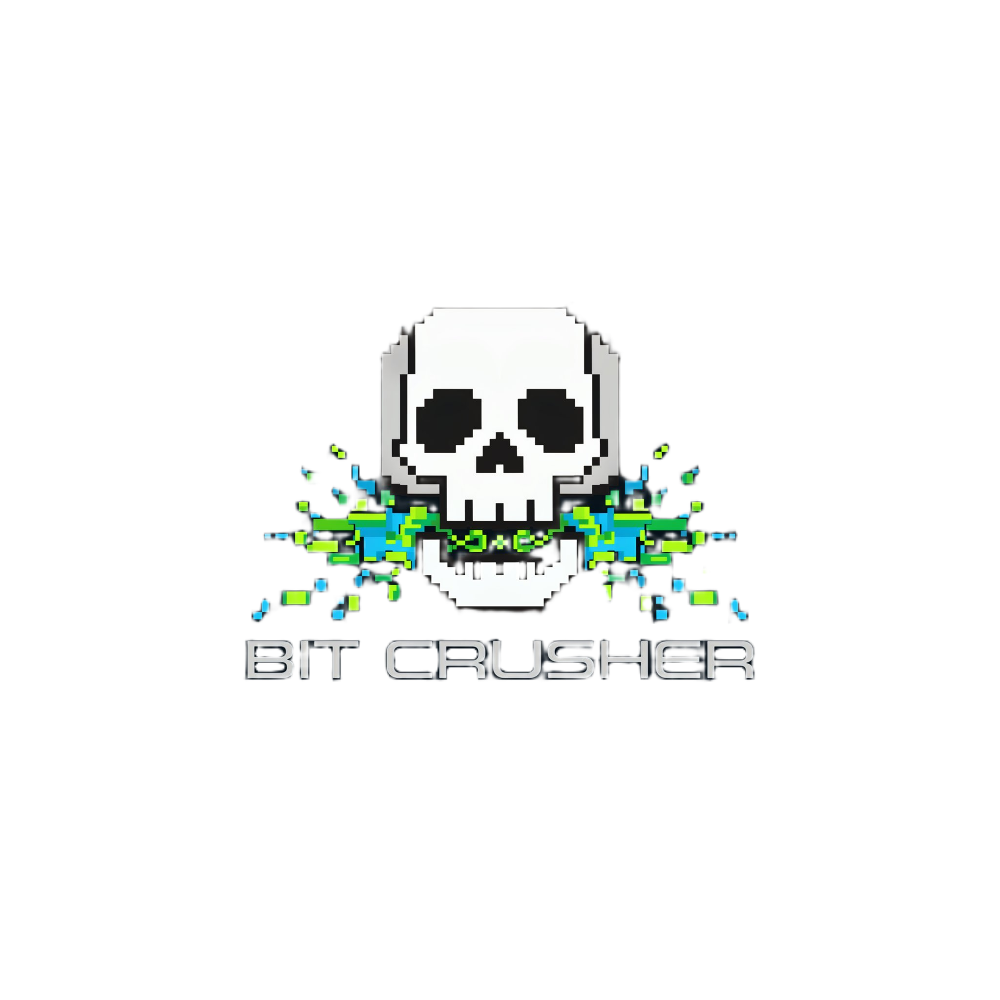

  <figure role="group" aria-labelledby="bct-logo-caption">
    
  </figure>

  <figure role="group" aria-labelledby="unipd-logo-caption">
    
  </figure>

# Progetto di Ingegneria del Software

> [!NOTE]
> Specifiche tecniche riguardo il progetto scelto non sono disponibili per completo.
> Attualmente il repo agisce come wrapper generico a scopo organizzativo per il team.

<aside>
  <strong>Gruppo:</strong> Bit Crusher &nbsp;|&nbsp;
  <strong>Relatore:</strong> Prof. Tullio Verdanega &nbsp;|&nbsp;
  <strong>Corso:</strong> Informatica (cod. SC1167), Università di Padova &nbsp;|&nbsp;
  <strong>Anno Accademico:</strong> 2026/2027
</aside>

## Panoramica ad alto livello

  <strong>[Prematuro per specifiche dettagliate -- da aggiornare]</strong>
  Il progetto è stato sviluppato nel contesto del corso di Ingegneria del Software
  e segue un processo di sviluppo agile con cicli di [Prematuro] settimane.

## Struttura del Progetto

<dl>
  <dt><code>docs/</code></dt>
  <dd>Documentazione di progetto (diario di bordo, verbali, capitolati, specifiche).</dd>

  <dt><code>src/</code></dt>
  <dd>Codice sorgente del software.</dd>

  <dt><code>tests/</code></dt>
  <dd>Suite di test (unitari, di integrazione, regressione).</dd>

  <dt><code>assets/</code></dt>
  <dd>Risorse statiche (immagini, diagrammi, template).</dd>
</dl>

## Diario di Bordo

  Il <strong>diario di bordo</strong> (<code>docs/diario_di_bordo/</code>)
  traccia l'andamento del progetto settimana per settimana: attività svolte,
  ostacoli incontrati, decisioni prese e obiettivi per il ciclo successivo.

  Il file sorgente è presente in
  <a href="./assets/latex_templates/diario_di_bordo.tex"><code>diario_di_bordo.tex</code></a>;
  mentre la versione compilata è disponibile come
  <a href="./docs/diario_di_bordo/diario_di_bordo.pdf"><code>diario_di_bordo.pdf</code></a>.

## Verbali delle Riunioni

  I <strong>verbali</strong> (<code>docs/verbali/</code>) documentano le
  riunioni di team: data, partecipanti, punti trattati, decisioni e compiti assegnati.

<table>
  <thead>
    <tr>
      <th>Data</th>
      <th>Tipologia</th>
      <th>Documento</th>
    </tr>
  </thead>
  <tbody>
    <tr>
      <td>[Da aggiornare]</td>
      <td>Primo incontro</td>
      <td><a href="./docs/verbali/verbale_01.pdf">Verbale 01</a></td>
    </tr>
  </tbody>
</table>

## Capitolati e Specifiche

  I <strong>capitolati</strong> (<code>docs/capitolati/</code>) sono organizzati
  in 10 cartelle (<code>C0</code>–<code>C9</code>). La cartella
  <code>scelta_priorita/</code> contiene la motivazione della scelta
  dei capitolati per priorità (1, 2, 3) e, in seguito, le specifiche dei requisiti (Prematuro).

<dl>
  <dt><a href="./docs/capitolati/C0/">C0</a></dt>
  <dd>AIRA: AI Requests Automation</dd>

  <dt><a href="./docs/capitolati/C1/">C1</a></dt>
  <dd>AURA: AI for Understanding, Reasoning and Automation</dd>

  <dt><a href="./docs/capitolati/C2/">C2</a></dt>
  <dd>Concierge</dd>

  <dt><a href="./docs/capitolati/C3/">C3</a></dt>
  <dd>Fossdot: Smart Speaker Open Source estensibile e rispettoso della privacy</dd>

  <dt><a href="./docs/capitolati/C4/">C4</a></dt>
  <dd>Gestione Veicoli e Servizi Post-Vendita</dd>
  
  <dt><a href="./docs/capitolati/C5/">C5</a></dt>
  <dd>RareCare: Piattaforma AI per la raccolta dati e il supporto decisionale nelle malattie rare</dd>

  <dt><a href="./docs/capitolati/C6/">C6</a></dt>
  <dd>Sistema AI di caching semantico e dashboard FinOps</dd>
  
  <dt><a href="./docs/capitolati/C7/">C7</a></dt>
  <dd>Smart Dashboard: Piattaforma di Business Intelligence potenziata da AI</dd>

  <dt><a href="./docs/capitolati/C8/">C8</a></dt>
  <dd>Sonar: Documentazione vivente di uno store Shopify</dd

  <dt><a href="./docs/capitolati/C9/">C9</a></dt>
  <dd>SpecCheck: Skills OpenCode per tracciabilità tra casi d'uso, requisiti e codice sorgente</dd>
</dl>

### Scelta per priorità

<table>
  <thead>
    <tr>
      <th>Priorità</th>
      <th>Capitolati</th>
      <th>Motivazione</th>
    </tr>
  </thead>
  <tbody>
    <tr>
      <td>1</td>
      <td>C6</td>
      <td>[Espansione in corso]</td>
    </tr>
    <tr>
      <td>2</td>
      <td>C3</td>
      <td>[Espansione in corso]</td>
    </tr>
    <tr>
      <td>3</td>
      <td>C1</td>
      <td>[Espansione in corso]</td>
    </tr>
  </tbody>
</table>

## Team

  I ruoli all'interno del gruppo sono <strong>a rotazione</strong>:
  ogni membro può assumere responsabilità diverse nei vari cicli
  di sviluppo.

<table>
  <thead>
    <tr>
      <th>Nome e Cognome</th>
      <th>Matricola</th>
      <th>GitHub</th>
    </tr>
  </thead>
  <tbody>
  <tr>
    <td>Alex Singh</td>
    <td>2148621</td>
    <td><a href="https://github.com/ZiraelOneTwo">@ZiraelOneTwo</a></td>
  </tr>
    
  <tr>
    <td>Pietro Leonardo Acampora</td>
    <td>2146762</td>
    <td><a href="https://github.com/hipietro">@hipietro</a></td>
  </tr>

  <tr>
    <td>Marco Bollettin</td>
    <td>2147955</td>
    <td><a href="https://github.com/Ahwrs">@Ahwrs</a></td>
  </tr>

  <tr>
    <td>Erik Giuliano</td>
    <td>2138012</td>
    <td><a href="https://github.com/FlameStorm199">@FlameStorm199</a></td>
  </tr>

  <tr>
    <td>Alexandru Mitu</td>
    <td>2101083</td>
    <td><a href="https://github.com/aycollapse">@aycollapse</a></td>
  </tr>
  
  <tr>
    <td>Riccardo Pozzato</td>
    <td>2147988</td>
    <td><a href="https://github.com/rpozzato">@rpozzato</a></td>
  </tr>

  <tr>
    <td>Antonio Tufano</td>
    <td>2137972</td>
    <td><a href="https://github.com/antotuf06">@antotuf06</a></td>
  </tr>
  </tbody>
</table>

## Setup ed Esecuzione

<ol>
  <li>Clona il repository:
    <pre><code>git clone https://github.com/BitCrusher-Team/Progetto_SWE_26-27.git</code></pre>
  </li>
  <li>Riproduci l'ambiente ed installa le dipendenze:
    <pre><code>[Prematuro]</code></pre>
  </li>
  <li>Esegui i test:
    <pre><code>[Prematuro]</code></pre>
  </li>
  <li>Lancia l'applicativo:
    <pre><code>[Prematuro]</code></pre>
  </li>
</ol>

## Riferimenti / Strumenti e Tecnologie

<ol>
  <li>[Prematuro, necessario a definire le risorse esterne o riferimenti tecnici]</li>
  <li>[Conterrà anche conformità a standard e normative nazionali/europee]</li>
</ol>

---

  <small>
    <em>Progetto sviluppato in collaborazione con [Prematuro] — Università di Padova, Informatica, AA 2026/2027</em>
  </small>

